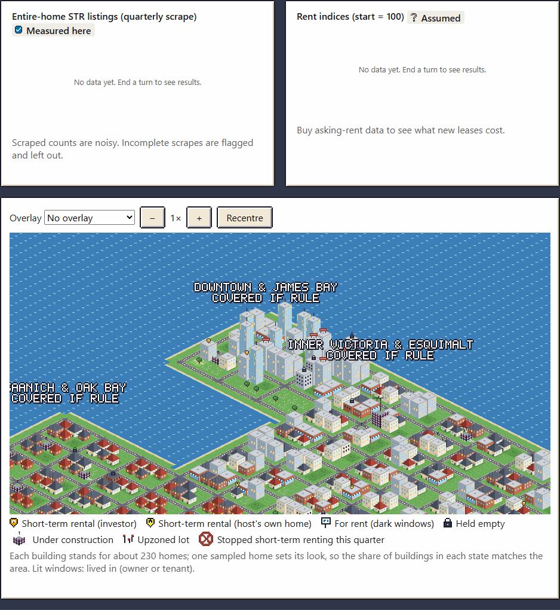
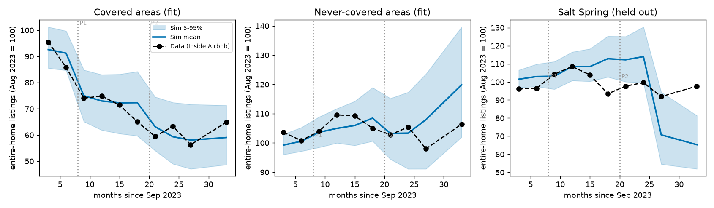
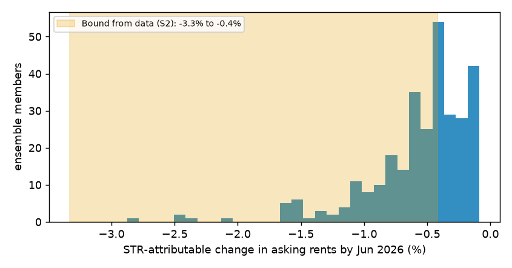
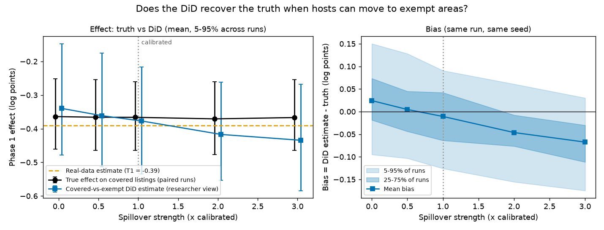

# Zoned Out

**A housing-policy game on an agent-based model calibrated to my own causal estimates of BC's
short-term rental law.** You are the housing minister for Greater Victoria for one five-year
term. Set short-term rental rules, enforcement, a vacancy tax, a rent cap, upzoning and
non-market building; watch what the data shows you; then see what really happened.

**Play it:** https://haji5.github.io/housing-policy-sim/ (runs entirely in your browser; to run
it locally, see [Reproduce](#reproduce)).



> I built a simulator calibrated to my own causal estimates, and then used it to test whether my
> difference-in-differences design recovers the true effect when displaced hosts can substitute
> into exempt areas.

## Three results

**1. The model reproduces the Bill 35 evidence it was calibrated to.** The first project
estimated that BC's principal-residence rule cut entire-home listings in Victoria's covered areas
by −0.390 log points (about −32%) against the exempt areas, with no pre-trends. The calibrated
ensemble gives −0.399 (5-95% −0.548 to −0.243), matches the covered and exempt listing paths
and shows no pre-trends. It misses the multi-listing-host share, the registered share and the
weak Phase 2 term, and a held-out test (Salt Spring Island's opt-in) fails; all are reported, not
tuned away ([CALIBRATION.md](docs/CALIBRATION.md), [VALIDATION.md](docs/VALIDATION.md)).



**2. The policy moves listings a lot and rents very little.** Inside the model, where the
counterfactual is known exactly, the rule cuts covered-area listings by 0.585 log points while
asking rents fall by 0.48% (5-95% across model variants: −0.66% to −0.30%), and the all-tenant
CPI-style index by 0.24%. CPI rented accommodation in Victoria rose 19.5% over the same period
and its monthly noise is about 2.4%, so a rent effect this size is **too small to detect** in
the data, which is what the first project found. That is not the same as no effect.



**3. The DiD design overstates the effect when the control group is contaminated.** Running the
first project's regression on simulated scraped data, with the truth known: at the calibrated
spillover strength it estimates −0.384 against a true −0.348, overstating the fall by 0.037 log
points (11%). The bias grows with spillover into the exempt areas, to 23% at three times the
calibrated strength. Read back onto the real estimate, the true Phase 1 effect is plausibly 0-20%
smaller than −0.390 ([VALIDATION.md §3](docs/VALIDATION.md#3-did-recovery-experiment-m4)).



## How it connects to the first project

[bc-str-ban-analysis](https://github.com/haji5/bc-str-ban-analysis)
([dashboard](https://haji5.github.io/bc-str-ban-analysis/)) estimated the effect of Bill 35 with
a covered-vs-exempt difference-in-differences on Inside Airbnb snapshots. Its estimates are this
project's calibration targets (`calibration/inputs/targets.json`, each with provenance), and its
estimator (pyfixest) is reused to check the simulator's own TypeScript DiD to 1e-14. This project
asks what that design cannot: where the displaced homes went, what that did to rents, and
whether the estimate itself is biased.

## The model in ten lines

- Monthly ticks; a game turn is a quarter; a term is 20 turns from September 2023.
- About 39,000 dwellings and 36,000 households in eight zones of the Capital Regional District
  (1 agent per 5 real units); five zones are covered by the rule, three are exempt.
- Investors choose short-term rental, long-term rental, holding empty or selling by a
  multinomial logit; hosts of their own principal residence stay legal.
- Enforcement detects and fines illegal listings; a registry de-lists unregistered ones.
- Market rents adjust to vacancy; sitting tenants' rents follow a cap on lease anniversaries.
- Developers start homes on margin, the policy rate and zoning headroom; completions lag 18-30
  months.
- Households search, double up or leave the region when they cannot find a home.
- A noisy "researcher view" (scraped snapshots, a noisy CPI) is what the player sees.
- 16 behavioural parameters are calibrated by simulated method of moments and ABC; the game
  draws from a 300-member ensemble, so each seed plays a different plausible model.
- Fully deterministic: a counter-based hashed RNG gives common random numbers, so every effect is
  a paired comparison with a no-policy run of the same city and luck.

Details: [ODD protocol](docs/ODD.md), [assumptions register](docs/ASSUMPTIONS.md) (every number
tagged DATA / LITERATURE / ASSUMED / VERIFY), [calibration](docs/CALIBRATION.md),
[validation](docs/VALIDATION.md), [decision records](docs/adr/),
[accessibility](docs/ACCESSIBILITY.md).

## Limitations

- **Not a forecast and not policy advice. Not affiliated with or commissioned by the Government
  of British Columbia.** It is a calibrated, simplified model, not a digital twin of Victoria.
- The listing response is calibrated; the rent, vacancy-tax, rent-cap, upzoning and
  non-market responses are assumptions (shown with "Assumed" badges in the game).
- The calibration's effective sample size is low (21; 179 distinct parameter sets among 300), and
  several targets and the Salt Spring hold-out are missed ([CALIBRATION.md](docs/CALIBRATION.md)).
- Levels of rent burden and housing stress are not calibrated; the game scores only changes
  against the no-policy run.
- Some real-world inputs are tagged VERIFY in [ASSUMPTIONS.md](docs/ASSUMPTIONS.md) (Census
  counts, incomes, construction rates, fine size, registration cost, BC rent caps by year): they
  have not been checked at source.
- The debrief replays 32 model variants rather than 200, to stay near 10 seconds
  ([ADR 0011](docs/adr/0011-debrief-and-onboarding.md)).

## Reproduce

Requires Node ≥ 24 and pnpm; Python 3.11 for calibration.

```bash
pnpm install
pnpm lint && pnpm typecheck && pnpm test   # sim tests include an 85% line-coverage gate
pnpm build && pnpm e2e                     # Playwright: play, keyboard-only, axe audit, budgets
pnpm e2e:live                              # smoke test of the deployed site (needs network)
pnpm dev                                   # http://localhost:5173
```

Calibration and validation (Python, `calibration/`; see [calibration/README.md](calibration/README.md)):

```bash
node scripts/py.mjs setup     # create calibration/.venv with the pinned requirements
pnpm calibrate                # ~45 min; writes the ensemble and calibration/reports/
pnpm validate                 # ~30 min: estimator check, parameter recovery, sensitivity
pnpm sobol                    # ~15 min: Sobol indices
pnpm did-recovery             # the DiD-recovery experiment
pnpm sim playtest --seeds 1,2,3,4,5,6,7,8 --out calibration/reports/playtest.json
```

Art is generated, not drawn: `pnpm art` rebuilds the sprite atlas. README media:
`MEDIA=1 npx playwright test e2e/media.spec.ts` (in `apps/web`), then
`calibration/.venv/Scripts/python.exe scripts/make_gif.py`.

## Performance

Measured on the development laptop (busy at the time) — PLAN §11 budgets:

| Budget                                     | Target     | Measured                                                   |
| ------------------------------------------ | ---------- | ---------------------------------------------------------- |
| Page script (gzipped)                      | < 400 KB   | 47 KB, plus two workers of 29 KB each                      |
| Sprite atlas                               | < 300 KB   | 6.4 KB PNG + 16 KB JSON                                    |
| First interaction                          | < 2 s      | start screen interactive at 74 ms; city built in 0.9 s     |
| One turn                                   | -          | 0.11 s (player and no-policy runs)                         |
| 10k agents × 60 ticks in Node              | < 150 ms   | passes the test's 600 ms CI margin                         |
| Victoria run (75k agents, 24 + 60 months)  | < 150 ms   | **not met**: 361 ms best, 404 ms median (`pnpm sim bench`) |
| Debrief ensemble in the browser, 4 workers | 200 < 10 s | **32 variants × 2 runs: 8-12 s** (ADR 0011)                |

## Tech stack

TypeScript (strict) in a pnpm workspace: a DOM-free simulation core (`packages/sim`) that runs
in Node for calibration and in Web Workers in the game; Preact for the UI, Canvas 2D for the
isometric map, hand-written SVG charts; Vitest and fast-check for invariants, Playwright and
axe-core for the UI. Calibration in Python with NumPy, SciPy, pandas, pyfixest and matplotlib.
All art is procedurally generated by `tools/art` (no image libraries). No analytics, no server.

## Licences and data attribution

- Code: MIT ([LICENSE](LICENSE)). Generated art, including the pixel font: CC BY 4.0.
- **Inside Airbnb** listing data (via the first project's aggregates): CC BY 4.0.
- **Statistics Canada** (CPI, Census): contains information licensed under the Open Government
  Licence – Canada.
- **CMHC** rental market survey benchmarks and the **Bank of Canada** neutral-rate range, via
  the first project's fixtures and published figures.

Only aggregate calibration targets are used; no raw listing data is in this repository. See the
in-game [About page](apps/web/public/about.html).
