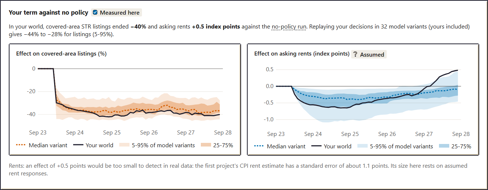

# Zoned Out

[](https://github.com/haji5/housing-policy-sim/actions/workflows/ci.yml)
[](https://haji5.github.io/housing-policy-sim/)
[](LICENSE)

**A housing-policy game on an agent-based model calibrated to my own causal estimates of British
Columbia's short-term rental law.** You are the housing minister for Greater Victoria for one
five-year term. Set short-term rental rules, enforcement, a vacancy tax, a rent cap, upzoning and
non-market building; watch the noisy data an analyst would see; then find out what really
happened.

**Play it:** https://haji5.github.io/housing-policy-sim/ (runs entirely in your browser).


At the end of the term, the debrief replays your decisions in 32 calibrated model variants and
shows what really happened, against what the noisy data let you see:



## At a glance

My [first project](https://github.com/haji5/bc-str-ban-analysis) estimated the effect of BC's
2024 principal-residence rule (Bill 35) on Airbnb-style listings with a difference-in-differences
design. A regression can only report what the data show. This project builds a simulated Greater
Victoria in which the true effect is known, calibrates it to those estimates, and asks three
questions the regression cannot answer:

| Question                                                     | Answer                                                                                                                                                                    | Evidence                                                                                            |
| ------------------------------------------------------------ | ------------------------------------------------------------------------------------------------------------------------------------------------------------------------- | --------------------------------------------------------------------------------------------------- |
| Can a structural model reproduce the measured listing drop?  | In sample, yes: −0.379 log points against the estimated −0.390. Several secondary targets and the one held-out test are missed.                                           | [Result 1](#1-the-model-reproduces-the-headline-estimate-it-was-calibrated-to-but-not-every-target) |
| What did the rule do to rents?                               | Asking rents about 0.6% lower by June 2026 (5-95%: −1.5% to −0.1%): **too small to detect** in the CPI. Its size rests on rent dynamics the listing data cannot identify. | [Result 2](#2-the-policy-moves-listings-a-lot-and-rents-little-and-how-little-rests-on-assumptions) |
| Is the DiD biased when displaced hosts move to exempt areas? | Only a little at plausible strengths: it overstates the effect by 3% at the calibrated spillover and understates it by 7% with none.                                      | [Result 3](#3-spillover-into-the-exempt-areas-barely-biases-the-did-at-plausible-strengths)         |

What the project demonstrates:

- **Econometrics and structural modelling.** Simulated method of moments with sequential Monte
  Carlo ABC (18 parameters, 300-member posterior ensemble), identification diagnostics,
  parameter-recovery tests, Sobol sensitivity analysis, and a Monte Carlo study of a DiD
  estimator under SUTVA violations, with the first project's estimator (pyfixest) reproduced to
  1e-14 in TypeScript.
- **Honest reporting.** Every number in the model is tagged DATA, LITERATURE, ASSUMED or VERIFY;
  misses are reported rather than tuned away; known weaknesses are listed [below](#limitations).
- **Software engineering.** A deterministic simulation core (counter-based RNG, common random
  numbers, property-based invariant tests, a coverage gate), Web Workers, CI with Playwright, an
  accessibility audit (axe, WCAG 2.1 AA) and procedurally generated art.

## Three results

### 1. The model reproduces the headline estimate it was calibrated to, but not every target

The first project estimated that the principal-residence rule cut entire-home listings in
Victoria's covered areas by −0.390 log points (about −32%) relative to the exempt areas, with no
pre-trends. The calibrated ensemble's mean is −0.379 (−0.377 weighting its 174 distinct parameter
sets equally); it tracks the covered-area listing path and shows no pre-trends. That is a fitted
target, not an out-of-sample test.

The fit is imperfect, and all of it is reported:

- The covered areas keep falling a little too long: the June 2026 point is just outside two
  standard errors.
- The model overshoots the exempt areas' growth from late 2025.
- It misses the multi-listing-host share, the registered share and the weak Phase 2 term.
- Even the best-fitting parameter set's distance is about four times what a correctly specified
  model would score.
- The one held-out test, Salt Spring Island's November 2025 opt-in, fails.

Details: [CALIBRATION.md](docs/CALIBRATION.md), [VALIDATION.md](docs/VALIDATION.md),
[robustness report](calibration/reports/robustness.md).


### 2. The policy moves listings a lot and rents little, and how little rests on assumptions

Inside the model, where the counterfactual is known exactly, the rules (principal residence plus
registry) cut covered-area listings by 0.640 log points by June 2026. Asking rents fall by 0.57%
(5-95% across the ensemble: −1.52% to −0.14%) and the all-tenant, CPI-style index by 0.30%.

- **Why so small.** Displaced homes mostly become long-term rentals that house additional
  households (arrivals respond to vacancy), rather than pushing rents down. Some buyers of homes
  that investors sell are local renters whose rentals are freed, but the rule causes too few net
  sales for that to matter (−0.02 points).
- **Why so uncertain.** Most of the spread comes from two things the listing data cannot pin
  down: how fast rents react to vacancy and how strongly vacancy draws renters into the region.
  Both are drawn over wide priors in the ensemble rather than fixed, so the range carries their
  uncertainty; they explain most of its variance ([Sobol](calibration/reports/sobol.md),
  [robustness](calibration/reports/robustness.md)).
- **What it means.** Even the largest effect in that range (−1.5%) is below two standard errors
  of the first project's CPI rent estimate (SE 1.1 points). The effect is **too small to detect**
  in the data, which is what the first project found. That is not the same as no effect, and the
  model does not measure its size.


### 3. Spillover into the exempt areas barely biases the DiD at plausible strengths

If the rule pushes tourist demand and investors into the exempt areas, the control group is
itself treated and the DiD overstates the effect. I ran the first project's regression on
simulated, noisy scraped data where the truth is known. Over the Phase 1 window:

- At the calibrated spillover strength it estimates −0.377 against a true −0.366, overstating the
  fall by 3%. With no spillover it understates the fall by 7%. Only spillover well beyond the
  calibrated range (2-3×) overstates it substantially (12-18%).
- Spillover strength is barely identified by the calibration, so I also checked it against the
  data: the control areas are untreated until late 2025, and their observed listing path fits half
  and full calibrated strength equally well (no spillover slightly worse). The evidence is weak.
- Read back onto the real estimate, the true Phase 1 effect is plausibly within about 7% of
  −0.390, in either direction.

Details: [VALIDATION.md §3](docs/VALIDATION.md#3-did-recovery-experiment-m4-re-run-on-the-current-ensemble).


## How it connects to the first project

[bc-str-ban-analysis](https://github.com/haji5/bc-str-ban-analysis)
([dashboard](https://haji5.github.io/bc-str-ban-analysis/)) estimated the effect of Bill 35 with
a covered-vs-exempt difference-in-differences on Inside Airbnb snapshots. Its estimates are this
project's calibration targets ([`calibration/inputs/targets.json`](calibration/inputs/targets.json),
each with provenance), and its estimator is reused to check the simulator's own DiD. This project
asks what that design cannot: where the displaced homes went, what that did to rents, and whether
the estimate itself is biased.

## The model in ten lines

- Monthly ticks; a game turn is a quarter; a term is 20 turns from September 2023.
- About 39,000 dwellings and 13,000 renter households in eight zones of the Capital Regional
  District (1 agent per 5 real units, so about 198,000 homes and 66,000 renter households);
  five zones are covered by the rule, three are exempt.
- Investors choose short-term rental, long-term rental, holding empty or selling, by multinomial
  logit; hosts of their own principal residence stay legal. Some buyers of sold homes are local
  renters.
- Enforcement detects and fines illegal listings; a registry de-lists unregistered ones.
- Asking rents adjust to vacancy; sitting tenants' rents follow a cap on lease anniversaries.
- Developers start homes on margin, the policy rate and zoning; completions lag 18-30 months.
- Households search, double up, or leave the region when they cannot find a home.
- A noisy "researcher view" (scraped snapshots with truncation, a noisy CPI) is all the player
  sees during the game.
- 18 parameters are calibrated; the game draws one member of the 300-member ensemble per seed
  (174 distinct parameter sets, effective sample size about 63), so different seeds play
  different plausible models.
- Fully deterministic: a counter-based hashed RNG gives common random numbers, so every effect is
  a paired comparison with a no-policy run of the same city and the same luck.

## Limitations

- **Not a forecast and not policy advice. Not affiliated with or commissioned by the Government
  of British Columbia.** It is a calibrated, simplified model, not a digital twin of Victoria.
- Only the listing response is calibrated. The rent, vacancy-tax, rent-cap, upzoning and
  non-market responses are assumptions (shown with "Assumed" badges in the game).
- The calibration's effective sample size is moderate (about 63 of 600; 174 distinct parameter
  sets among 300, the most frequent repeated 26 times), so the tails of its 5-95% ranges rest on a
  few effective draws.
- The rent effect's size is set by rent dynamics the data cannot identify. Their priors are wide
  but assumed. Owner-occupiers are not agents: an unverified 40% of buyers of sold homes are taken
  to be local renters, and sellers are assumed to leave the rental market.
- Over a full five-year game term the listing rule's rent effect fades, and in about a third of
  model variants asking rents end slightly above the no-policy run (mean −0.11 points at month 59,
  against −0.34 at month 33). With the short-term option gone, the investor logit raises every
  covered-zone landlord's odds of selling to an owner-occupier (an IIA property), so about 1,200
  homes on average leave the rental stock over the term. How strong that channel really is has not
  been measured ([VALIDATION §5](docs/VALIDATION.md#5-known-limitations)).
- Enforcement levels other than the default are an extrapolation: detection at the default level
  is calibrated, but how it scales with the level is assumed.
- Levels of rent burden and housing stress are not calibrated; the game scores only changes
  against the no-policy run.
- Some real-world inputs are tagged VERIFY in [ASSUMPTIONS.md](docs/ASSUMPTIONS.md) (Census
  counts, incomes, construction rates, fine size, registration cost, BC rent caps by year): they
  have not been checked at source.
- The end-of-game debrief replays 32 model variants rather than 200, to stay near 10 seconds
  ([ADR 0011](docs/adr/0011-debrief-and-onboarding.md)).

## Documentation

| Document                                      | What it covers                                                                                                                                                                                                                                                            |
| --------------------------------------------- | ------------------------------------------------------------------------------------------------------------------------------------------------------------------------------------------------------------------------------------------------------------------------- |
| [ODD protocol](docs/ODD.md)                   | The full model specification in the standard Overview, Design concepts, Details format: entities, schedule, every equation.                                                                                                                                               |
| [Assumptions register](docs/ASSUMPTIONS.md)   | Every number and functional form, with its value, provenance tag (DATA / LITERATURE / ASSUMED / VERIFY) and source.                                                                                                                                                       |
| [Calibration](docs/CALIBRATION.md)            | Targets, method (SMM / ABC-SMC), fit by target, identification, and the history of calibration runs.                                                                                                                                                                      |
| [Validation](docs/VALIDATION.md)              | Automated tests, estimator cross-check, parameter recovery, sensitivity, out-of-sample checks, the DiD experiment and balance playtests.                                                                                                                                  |
| [Decision records](docs/adr/)                 | Thirteen architecture and modelling decisions (ADRs), each with its context, the decision and its consequences.                                                                                                                                                           |
| [Accessibility](docs/ACCESSIBILITY.md)        | The accessibility checklist and how each item is tested.                                                                                                                                                                                                                  |
| [Calibration pipeline](calibration/README.md) | How the Python pipeline drives the simulator, and its commands.                                                                                                                                                                                                           |
| [Generated reports](calibration/reports/)     | Machine-written results: [calibration](calibration/reports/calibration.md), [validation](calibration/reports/validation.md), [Sobol](calibration/reports/sobol.md), [DiD recovery](calibration/reports/did_recovery.md), [robustness](calibration/reports/robustness.md). |

Key decision records: [0004](docs/adr/0004-m3-victoria-calibration-model.md) Victoria scenario
and calibration mechanics, [0006](docs/adr/0006-researcher-view.md) the researcher view,
[0007](docs/adr/0007-investor-choice-and-rent-cap.md) investor choice and the rent cap,
[0009](docs/adr/0009-game-layer.md) game rules and scoring,
[0013](docs/adr/0013-renter-buyers-rent-uncertainty-abc-smc.md) renter buyers, rent-dynamics
uncertainty and ABC-SMC.

## Repository layout

```text
packages/sim/   deterministic simulation core (TypeScript, no DOM); runs in Node and Web Workers
apps/web/       the game: Preact UI, isometric Canvas map, SVG charts, Playwright tests
calibration/    Python pipeline: calibration, validation, Sobol, DiD recovery, robustness
tools/art/      procedural pixel-art generator (sprite atlas, UI kit, pixel font)
docs/           model specification, assumptions, calibration, validation, decision records
```

## Reproduce

Requires Node 24 or later and pnpm; Python 3.10-3.13 for the calibration pipeline.

```bash
pnpm install
pnpm lint && pnpm typecheck && pnpm test   # sim tests include an 85% line-coverage gate
pnpm build && pnpm e2e                     # Playwright: play, keyboard-only, axe audit, budgets
pnpm dev                                   # http://localhost:5173
```

Calibration and validation ([calibration/README.md](calibration/README.md)); times are for a
16-thread laptop:

```bash
node scripts/py.mjs setup     # create calibration/.venv with the pinned requirements
pnpm calibrate                # ~2.5 h; writes the ensemble and calibration/reports/ (resumes from a cache)
pnpm validate                 # ~35 min: estimator check, parameter recovery, sensitivity
pnpm sobol                    # ~15 min: Sobol indices
pnpm did-recovery             # ~10 min: the DiD-recovery experiment
pnpm robustness               # ~5 min: fit diagnostics, rent-assumption and renter-buyer sensitivity
pnpm sim playtest --seeds 1,2,3,4,5,6,7,8 --out calibration/reports/playtest.json
```

The sprite atlas is generated, not drawn: `pnpm art` rebuilds it. The README animation comes from
`MEDIA=1 npx playwright test e2e/media.spec.ts` (in `apps/web`) and `scripts/make_gif.py` (run
with the calibration environment's Python, which has Pillow).

## Performance

Measured on the development laptop (Node, headless Chromium) against budgets set at the start of
the project:

| Budget                                     | Target     | Measured                                                          |
| ------------------------------------------ | ---------- | ----------------------------------------------------------------- |
| Page script (gzipped)                      | < 400 KB   | 58 KB, plus two workers of 31 and 32 KB                           |
| Sprite atlas                               | < 300 KB   | 6.7 KB PNG + 17.7 KB JSON                                         |
| First interaction                          | < 2 s      | start screen interactive at 70 ms; city built in 0.4 s            |
| One turn                                   | -          | 0.10 s (player and no-policy runs)                                |
| 10k agents × 60 ticks in Node              | < 150 ms   | 37 ms best, 38 ms median (13k agents)                             |
| Victoria run (78k agents, 24 + 60 months)  | < 150 ms   | **not met**: 293 ms best, 308 ms median (`pnpm sim bench`)        |
| Debrief ensemble in the browser, 4 workers | 200 < 10 s | **32 variants × 2 runs: 6.0 s** (N = 200 not attempted, ADR 0011) |

## Tech stack

TypeScript (strict) in a pnpm workspace: a DOM-free simulation core that runs in Node for
calibration and in Web Workers in the game; Preact for the UI, Canvas 2D for the isometric map,
hand-written SVG charts; Vitest and fast-check for invariants, Playwright and axe-core for the UI.
Calibration in Python with NumPy, SciPy, pandas, pyfixest and matplotlib. All art is procedurally
generated by `tools/art` (no image libraries). No analytics and no server: the game is static
files.

## Licences and data attribution

- Code: MIT ([LICENSE](LICENSE)). Generated art, including the pixel font: CC BY 4.0.
- **Inside Airbnb** listing data (via the first project's aggregates): CC BY 4.0.
- **Statistics Canada** (CPI, Census): contains information licensed under the Open Government
  Licence – Canada.
- **CMHC** rental market survey benchmarks and the **Bank of Canada** neutral-rate range, via the
  first project's fixtures and published figures.

Only aggregate calibration targets are used; no raw listing data is in this repository. See the
in-game [About page](apps/web/public/about.html).
