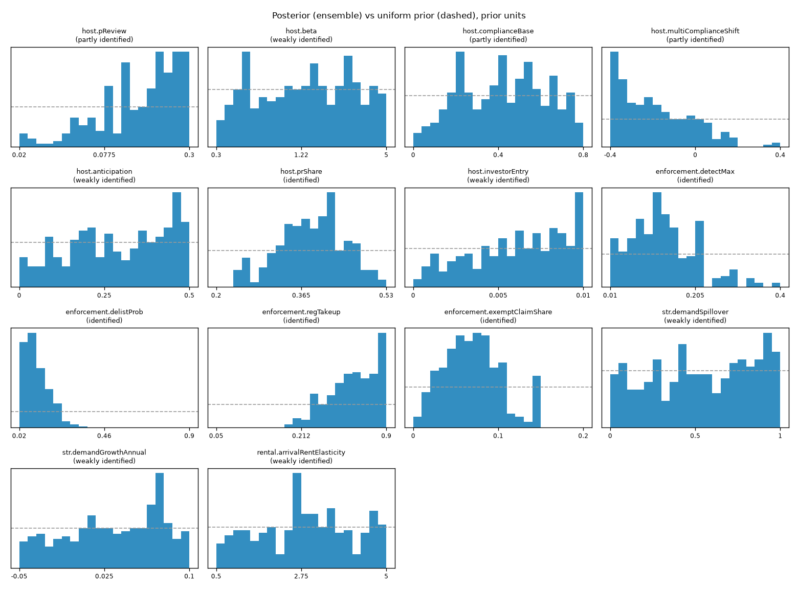

# Calibration report

_Generated by `calibration/calibrate.py` on 2026-10-12 at commit `c3d6dc7` (sim 0.6.0). Do not edit by hand._

## Run

- Method: Sobol stage 1 -> Nelder-Mead stage 2 (diagnostic) -> ABC-SMC stage 3 (population Monte Carlo).
- Stage 1: 8192 Sobol draws; Stage 3: 22528 ABC-SMC proposals; common seeds [1, 2, 3, 4].
- ABC-SMC generations (tolerance, ESS of the population): 0: D <= 179.4, ESS 600; 1: D <= 153.8, ESS 212; 2: D <= 132.0, ESS 179; 3: D <= 120.4, ESS 118; 4: D <= 114.9, ESS 85; 5: D <= 115.7, ESS 154; 6: D <= 108.4, ESS 166; 7: D <= 102.8, ESS 150; 8: D <= 97.9, ESS 116; 9: D <= 95.6, ESS 51; 10: D <= 93.6, ESS 33; 11: D <= 89.4, ESS 62.
- Final tolerance D <= 89.3649; population 600; effective sample size 62.5; ensemble of 300 parameter sets (174 distinct), resampled by importance weight.
- Best distance found: 33.6468. Stage-1 median distance: 380.8.
- Hashes: priors `5f56ac68b1acb73c`, targets `5c69539c747b68a0`, defaults `6c48310be47b90c5`, scenario `a999702d005f859a` (checked by `packages/sim/test/ensemble.test.ts`).

## Fit (ensemble mean and 5-95% range vs target)

Pass = ensemble mean within 2 standard errors of the target (paths: last point).

| ID | Moment | Role | Target | Sim mean | Sim 5% | Sim 95% | Path RMSE | Pass |
|---|---|---|---:|---:|---:|---:|---:|---|
| T1 | `didP1` | fit | -0.390 | -0.379 | -0.569 | -0.264 | - | yes |
| T1a | `didAntic` | fit | -0.123 | -0.093 | -0.190 | -0.024 | - | yes |
| T2 | `didP2` | fit | -0.115 | -0.241 | -0.396 | -0.090 | - | **no** |
| T3 | `coveredPath` | fit | -0.432 | -0.535 | -0.698 | -0.343 | 0.058 | **no** |
| T4 | `exemptPath` | fit | 0.062 | 0.176 | 0.052 | 0.327 | 0.052 | yes |
| T5 | `multiShareEnd` | fit | 0.376 | 0.260 | 0.218 | 0.308 | - | **no** |
| T6a | `registeredShareEnd` | fit | 0.700 | 0.597 | 0.506 | 0.698 | - | **no** |
| T6b | `exemptClaimShareEnd` | fit | 0.094 | 0.081 | 0.008 | 0.160 | - | yes |
| H1 | `optInPath` | holdout | -0.024 | -0.426 | -0.661 | -0.196 | 0.178 | **no** |
| S1 | `cpiChangeEnd` | sanity | 0.178 | -0.003 | -0.027 | 0.010 | - | - |
| S2 | `effects.askingRent` | validation | [-0.0333, -0.0042] | -0.006 | -0.015 | -0.001 | - | - |

**T7 pre-trends.** Ensemble-mean event-study leads at the four pre-announcement snapshots: -0.024, -0.015, +0.009, -0.002 (target 0; real-data leads pass with RI p = 0.92).

## What the calibrated model says about rents (validation, not fitted)

- STR-attributable change in asking rents by Jun 2026 (paired no-policy runs): mean -0.57%, 5-95% -1.52% to -0.14%. Share of the ensemble inside the S2 bound (-3.3% to -0.4%): 60%.
- Same for the CPI-style (all-tenant) index: mean -0.30%. Either way the effect is small relative to the +19.5% CPI rise (S1), i.e. too small to detect in CPI data.
- True causal effect of the policy on covered-area listings (paired runs): mean -0.640 log points; on never-covered listings +0.043 (spillover).

## Paths

## Parameters and identification

Contraction = 1 - Var(posterior)/Var(prior) on the unit-cube scale. Labels: >= 0.5 identified, 0.2-0.5 partly identified, < 0.2 weakly identified. Weakly identified parameters carry their uncertainty into the game through the ensemble.

| Parameter | Prior | Median | 5% | 95% | Contraction | Label |
|---|---|---:|---:|---:|---:|---|
| `host.pReview` | loguniform[0.02, 0.3] | 0.1314 | 0.0276 | 0.2711 | 0.21 | partly identified |
| `host.beta` | loguniform[0.3, 5] | 1.904 | 0.3691 | 4.586 | 0.02 | weakly identified |
| `host.complianceBase` | uniform[0, 0.8] | 0.4109 | 0.112 | 0.7286 | 0.31 | partly identified |
| `host.multiComplianceShift` | uniform[-0.4, 0.4] | -0.2041 | -0.3722 | 0.05372 | 0.67 | identified |
| `host.anticipation` | uniform[0, 0.5] | 0.2811 | 0.06507 | 0.4164 | 0.30 | partly identified |
| `host.prShare` | uniform[0.2, 0.53] | 0.3502 | 0.2233 | 0.5155 | 0.15 | weakly identified |
| `host.investorEntry` | uniform[0, 0.01] | 0.005365 | 0.001515 | 0.009789 | 0.13 | weakly identified |
| `enforcement.detectMax` | uniform[0.01, 0.4] | 0.1237 | 0.03411 | 0.2603 | 0.66 | identified |
| `enforcement.delistProb` | uniform[0.02, 0.9] | 0.1019 | 0.02906 | 0.2912 | 0.88 | identified |
| `enforcement.regTakeup` | loguniform[0.05, 0.9] | 0.3791 | 0.2141 | 0.7569 | 0.73 | identified |
| `enforcement.exemptClaimShare` | uniform[0, 0.2] | 0.06152 | 0.00901 | 0.1137 | 0.69 | identified |
| `str.demandSpillover` | uniform[0, 1] | 0.5068 | 0.07017 | 0.9711 | 0.05 | weakly identified |
| `str.demandGrowthAnnual` | uniform[-0.05, 0.1] | 0.05398 | -0.03542 | 0.09768 | -0.03 | weakly identified |
| `rental.arrivalRentElasticity` | uniform[0.5, 5] | 3.017 | 0.7269 | 4.858 | 0.02 | weakly identified |
| `host.vacantHeldShare` | uniform[0.005, 0.08] | 0.0466 | 0.008746 | 0.07578 | -0.04 | weakly identified |
| `host.sellRateAnnual` | uniform[0.02, 0.1] | 0.03239 | 0.02005 | 0.07228 | 0.50 | identified |
| `rental.kappa` | loguniform[0.03, 0.3] | 0.1243 | 0.03905 | 0.2785 | 0.08 | weakly identified |
| `rental.arrivalVacancySemiElasticity` | uniform[0, 50] | 29.94 | 5.424 | 47.22 | 0.15 | weakly identified |

Strongest posterior correlations (trade-offs the data cannot separate):

- `host.pReview` vs `enforcement.detectMax`: +0.52
- `host.complianceBase` vs `enforcement.detectMax`: -0.50
- `host.pReview` vs `enforcement.delistProb`: +0.50
- `host.prShare` vs `host.sellRateAnnual`: -0.47
- `host.complianceBase` vs `host.multiComplianceShift`: -0.45
- `host.pReview` vs `host.prShare`: +0.40

